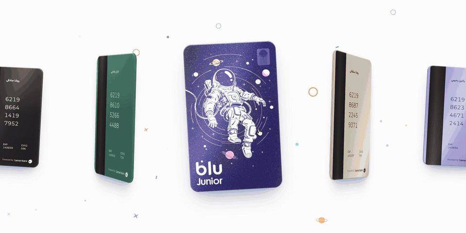

# Premium Cards — 3D carousel

A 3D carousel of seven of the world's most premium metal cards: Apple Card, X Money, American Express Centurion and Platinum, J.P. Morgan Reserve, Chase Sapphire Reserve and the Luxury Card Gold Card. Click anywhere to glide to the next card; move the mouse to tilt it.

**Live:** https://blu-bank-cards-animation-2.vercel.app

<p align="center">
  <a href="https://blu-bank-cards-animation-2.vercel.app"></a>
</p>

▶️ Full-quality video (1920×1080, 60 fps, loops): [docs/demo.mp4](docs/demo.mp4) — recorded with the earlier Blu Junior designs.

- **Front:** drawn in code, no image files — brushed metal, laser-etched wordmark (a simple nod to each brand's logo), gold chip, contactless mark, holder name, one-colour Visa or Mastercard mark. No number on the front, like real premium cards.
- **Back:** magnetic stripe, etched card number (Visa 4… / Mastercard 51–55… / Amex 34 or 37, valid Luhn check digit), expiry, CVV and holder name — random on every load.
- **3D:** layered card edge, moving gloss, light shading and soft shadows — pure CSS 3D transforms, no 3D library.

## Run it

```bash
npm install
npm run dev
```

## Record the demo video

Filmed frame by frame on a virtual clock (no dropped frames): the macOS pointing-hand cursor rests on the card and clicks through all seven cards with real clicks, ending where it started so the video loops.

```bash
npm i --no-save puppeteer-core
npm run build
node tools/record.mjs demo-4k.mp4            # 1280×720 page → 3840×2160 video
```

Needs Google Chrome and ffmpeg.

## Stack

Vite · React 18 · TypeScript · Tailwind CSS v4 · `requestAnimationFrame` (no animation libraries).

- `src/App.tsx` — carousel motion, 3D card body and lighting
- `src/cards.tsx` — the seven card designs, front and back faces, random holder data

## Credits

Brand names, logos and card products belong to their owners; the designs here are loose, non-commercial concept versions, not the real cards. All card details are randomly generated and not real.

Design experiment by [Hamzeh](https://hamzeh.framer.ai/?utm_source=blu-bank-cards-animation-2&utm_medium=referral) · Built with Claude.
